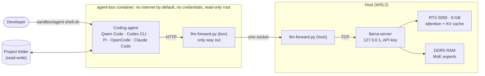

# Local agentic coding on an 8 GB GPU

[](https://github.com/leandro-andrade-candido/ai-local/actions/workflows/ci.yml)
[](LICENSE)

> 🇧🇷 Versão em português: [README.pt-BR.md](README.pt-BR.md). The detailed stage logs and verification reports are in Portuguese; the key findings are summarized in English below.

**Can a consumer PC run a coding agent comparable to the paid cloud tools, using open-weight models and mostly open-source tools, with zero recurring API cost?**

This repository is my measured attempt to answer that question. It runs a 35B-parameter Mixture-of-Experts model on an **RTX 5050 with 8 GB of VRAM**, is set up for five different coding agents, and runs those agents inside a **locked-down container** so they can work autonomously without reaching my credentials, my network or the rest of my machine.

**Status:** local inference and the sandbox are done and measured. The head-to-head comparison of the agents is next.

It is a measurement-driven project, not a tutorial: every decision has a recorded reason, every number states how it was obtained, and the completed stages were re-checked by a separate AI reviewer agent that re-ran the measurements and tried to break the claims.

## Results so far

Measured on this machine (Ryzen 9 9900X3D, 64 GB DDR5-5600, RTX 5050 8 GB, WSL2 / Ubuntu 24.04), model **Qwen3.6-35B-A3B** (Unsloth UD-Q4_K_XL, 22.4 GB), llama.cpp build `b11982`:

| What an agent experiences | 20k-token context | 64k | ~120k |
|---|---|---|---|
| Cold prompt (cache miss), prefill time | **16.2 s** (1,242 tok/s) | 58.2 s | 128.6 s |
| Warm turn (+350–450 new tokens) | **1.0–1.2 s** | 1.2–1.3 s | 1.3–1.5 s |
| Generation speed | **30–32 tok/s** | 25–26 tok/s | 21–23 tok/s |

The independent re-run reproduced these within about ±5%.

- **128k-token context** with a single slot and quantized KV cache (q8_0), on a GPU whose memory is about a third of the model's size.
- **Sandbox:** 150/150 escape tests pass (filesystem, credentials, network, resource limits, host-side processing of agent output).
- **Server hardening:** API key required on every endpoint except `/health`, localhost only, admin endpoints disabled, 13 automated health checks.
- **Reproducible:** runtime, model files (by revision **and** SHA-256), agents (sha512 of each tarball) and the container base image (digest) are all pinned.

Full benchmark report: [`bench/RESULTADOS-E4.md`](bench/RESULTADOS-E4.md) (Portuguese).

## Architecture



**Key idea: split the MoE model across GPU and RAM.** Only ~3B of the 35B parameters are active per token. Attention layers and the KV cache stay on the GPU; most expert weights stay in system RAM and are computed by the CPU. Generation then ends up bounded by the per-layer CPU↔GPU hand-offs (~76 per token), not by RAM bandwidth or VRAM size.

## Findings that were not obvious

These came out of systematic benchmarking (sweeps over offload depth, batch sizes, threads, memory locking and caching), not from documentation. Numbers are from the independent re-run.

1. **For short turns, computing experts on the CPU beats copying them to the GPU.** At 128-token batches, keeping experts on the CPU gave 400 tok/s versus 181 tok/s when shipping them over PCIe (2.2×). The crossover is around 1,000 tokens, which is why the profile sets `GGML_OP_OFFLOAD_MIN_BATCH=1024`.
2. **The expert cache made things worse.** `--moe-cache-mib 1024` cut generation speed by 22%: the CPU computes faster than PCIe can deliver the weights.
3. **More threads were slower.** 16 threads gave 18–19% slower generation than 8 threads.
4. **Prefill pays a fixed ~1 s cost per micro-batch**, so 4,096-token micro-batches gave +45% on long prompts compared with 2,048.
5. **An adversarial review found a real hole.** No escape from inside the container was found, but the *host-side* scripts that collected the agent's output followed symlinks the agent could plant, enabling arbitrary file read and write on the host. The fix removes every planted symlink before the host touches the output and never follows links; it is covered by 13 dedicated regression tests. See the [attack report](docs/verificacoes/E7.md) and the [sandbox README](sandbox/README.md).

## How it was built

The work follows an explicit process, documented stage by stage:

- **Diagnosis before installation.** Hardware audit, research on models, runtimes and agents, alternatives with trade-offs, and an approved plan before anything was installed ([`DIAGNOSTICO-E-PLANO.md`](DIAGNOSTICO-E-PLANO.md)).
- **Evidence labels.** Every claim is tagged *measured*, *verified at the primary source*, *reported by a cited source*, *estimated* or *unverified*.
- **Independent verification.** Stages E1–E4 and E7 were checked by a separate AI reviewer agent that re-ran the measurements and tried to break the claims; reports are in [`docs/verificacoes/`](docs/verificacoes/).
- **AI-assisted, human-directed.** I built it by directing AI coding agents and reviewing their output. The evaluation suite here measures whether local agents can do that same kind of work.

## Status and roadmap

Stages are numbered as planned; E7 (sandbox) ran before E6 because the agents must be isolated before they are benchmarked in autonomous mode.

| Stage | Description | Status |
|---|---|---|
| E0–E4 | Hardware/WSL tuning, pinned runtime, smoke test, model selection and benchmarks | ✅ done (E1–E4 independently verified) |
| E5 | `llama-server` as a hardened user service | 🟡 service running and healthy; reasoning-budget tuning and full tool-calling battery in progress |
| E7 | Isolation container, permissions, command guard | ✅ done; host-side hole fixed (150/150); adversarial re-check of the fix pending |
| E6 | Bake-off of the five agents on the local model | ⏳ next: configs and protocol ready in [`agents/`](agents/) |
| E8 | Validation on 7 tasks (T1–T7), 3 smoke tasks and a pilot on a real private project | ⏳ suite ready and validated without a model; manual first use done |
| E9 | Operations documentation | ⏳ |

The question this project still has to answer, and that I will publish with numbers when E6 and E8 are done: **how close does the best local agent get to a frontier cloud agent on the same tasks?**

## Quickstart

Requirements: Linux or WSL2 with systemd, an NVIDIA GPU with ≥ 8 GB and a recent driver, ~64 GB RAM, and Docker (for the agent sandbox; the model server runs natively). Commands run from the repository root.

```bash
scripts/install-llama-cpp.sh          # pinned llama.cpp build (versions.env)
scripts/fetch-model.sh qwen3.6-35b    # ~22 GB, verified by SHA-256 (models.tsv)
scripts/llm install                   # systemd user service (not enabled at login)
scripts/llm preflight && scripts/llm start && scripts/llm health

sandbox/build.sh                      # agent-box image (~4 GB)
sandbox/escape-tests.sh               # should report everything passing
sandbox/agent-shell.sh codex-local ~/path/to/project   # or qwen-code, pi, opencode, claude-local
```

The operational guide (Portuguese) is [`GUIA-DE-USO.md`](GUIA-DE-USO.md).

## Repository layout

| Path | Contents |
|---|---|
| `versions.env`, `models.tsv` | Single source of truth for pinned versions, ports, model revisions and hashes |
| `scripts/` | Installers and the `llm` command (start/stop/health/model switching/tool-call tests) |
| `runtime/` | `llama-server` profile, security policy and systemd unit |
| `bench/` | Benchmark scripts and summarized results |
| `agents/` | Per-agent configs and wrappers, plus the shared command guard and its tests |
| `sandbox/` | The `agent-box` container, the network forwarder and the escape tests |
| `eval/` | Evaluation suite: tasks with hidden tests, mutation checks and graders |
| `docs/` | Stage logs and independent verification reports |

The hidden tests and reference solutions in `eval/` are public, so future models may have seen them; treat results on these tasks accordingly.

## License

[MIT](LICENSE). Model weights are downloaded from their original sources under their own licenses (Qwen3.6 is Apache-2.0).
